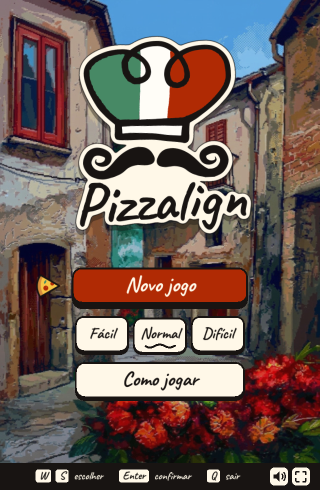
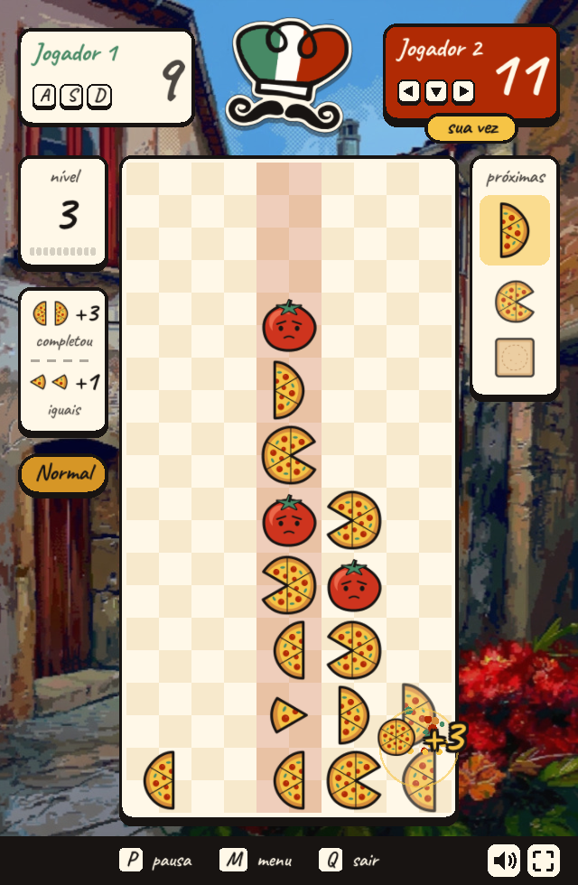
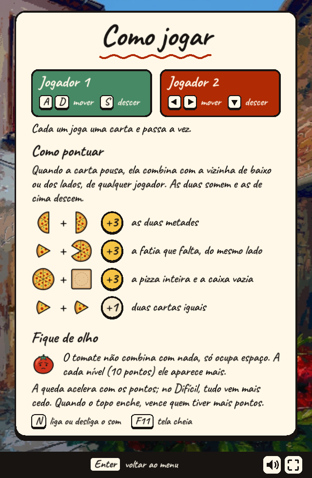
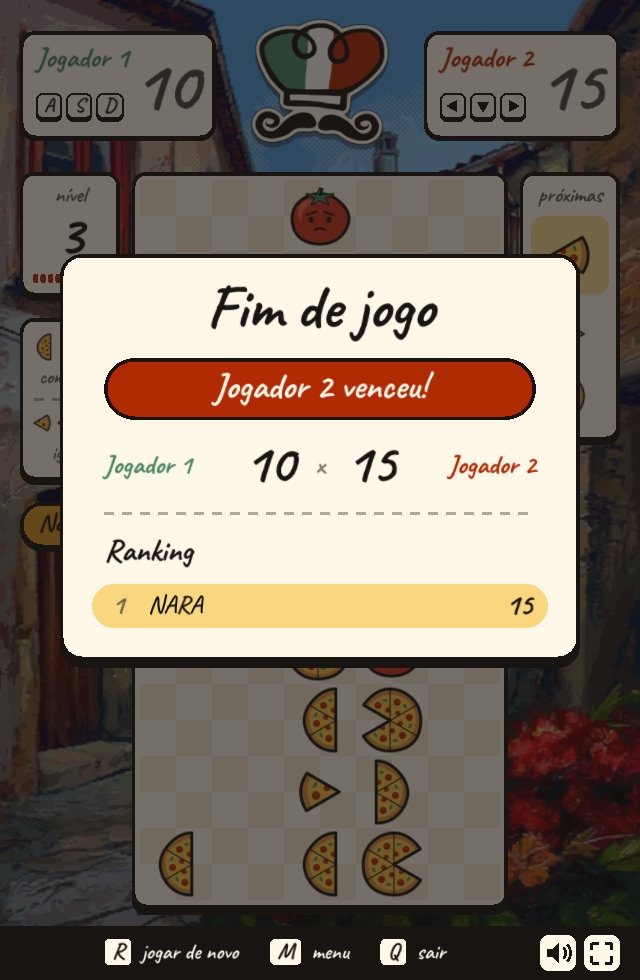

<h1 align="center">🍕 PizzAlign</h1>

<p align="center">
  Um jogo de queda de cartas para dois jogadores: complete pizzas, some pontos e não deixe o tabuleiro encher.
</p>

<p align="center">
  <a href="https://github.com/thelimacosta/pizzalign/actions/workflows/compilar.yml"></a>
</p>

<p align="center">
  
  &nbsp;
  
</p>

## Sumário

- [Jogar agora (Windows)](#jogar-agora-windows)
- [Sobre o jogo](#sobre-o-jogo)
- [Regras](#regras)
- [Dificuldade](#dificuldade)
- [Controles](#controles)
- [Compilar a partir do código](#compilar-a-partir-do-código)
- [Estrutura do projeto](#estrutura-do-projeto)
- [Conceitos de C aplicados](#conceitos-de-c-aplicados)
- [Créditos](#créditos)
- [Equipe](#equipe)

## Jogar agora (Windows)

Não precisa instalar nada:

1. Abra a [última versão](https://github.com/thelimacosta/pizzalign/releases/tag/ultima-versao) na página de releases.
2. Baixe o `pizzalign-windows.zip` e extraia.
3. Abra o `pizzalign.exe`.

Esse arquivo é gerado automaticamente pelo GitHub Actions a cada mudança na `main`. Imagens, fonte, sons e música já vão dentro do executável.

## Sobre o jogo

**PizzAlign** mistura a lógica de quebra-cabeças com a tensão dos jogos de queda de blocos. Dois jogadores se revezam soltando cartas de pizza num tabuleiro compartilhado. Quando duas cartas se completam, elas viram pontos e somem, e o tabuleiro respira. Quando a pilha chega ao topo, a partida acaba e vence quem tiver mais pontos.

O design e as mecânicas vêm de vários títulos:

| Inspiração | O que veio dela |
| :--- | :--- |
| **Tetris** | Gravidade contínua, tabuleiro em matriz e a necessidade de abrir espaço antes que transborde. |
| **Half Moon (Google)** | A ideia de juntar frações para formar um círculo completo, aqui uma pizza. |
| **Suika Game** | Fusão baseada em compatibilidade entre peças. |
| **Overcooked** | O clima de cozinha: ingredientes, madeira e personalidade. |
| **Make7 / 2048** | Cartas bem marcadas no tabuleiro. |
| **Tetris Effect** | Feedback que torna cada combinação satisfatória: pontos subindo, farelos voando e um som para cada fusão. |

## Regras

**O tabuleiro** tem 10 x 20 quadradinhos, e cada carta ocupa 2 x 2 deles, o que dá uma grade de 5 colunas por 10 linhas de cartas.

**As cartas** são 8, mais o tomate:

| Carta | Complementa com |
| :--- | :--- |
| Fatia (lado esquerdo) | Pizza faltando a fatia (lado esquerdo) |
| Fatia (lado direito) | Pizza faltando a fatia (lado direito) |
| Metade esquerda | Metade direita |
| Caixa vazia | Pizza inteira |

**A rodada**

1. Os jogadores se revezam, uma carta cada. O Jogador 1 começa.
2. Só o jogador da vez controla a carta que está caindo.
3. Quando a carta pousa, o jogo olha a carta de **baixo** e as dos **lados** (esquerda e direita), de qualquer jogador.
4. Se a vizinha **completa** a pizza com ela, as duas se fundem e somem. Só encaixa o lado equivalente, como na tabela acima.
5. Se a vizinha for **exatamente a mesma carta**, as duas também se fundem e somem.
6. Em qualquer outro caso, a fusão falha e a carta apenas se empilha.
7. Quando as cartas somem, as de cima descem e podem pontuar de novo, em cascata.

**Pontuação**

| Combinação | Pontos |
| :--- | :---: |
| Completar uma pizza | **3** |
| Juntar duas cartas iguais | **1** |

Os pontos vão para o jogador que soltou a carta.

**Tomate:** o tomate nunca pontua nem se funde, só ocupa espaço. A chance de ele aparecer cresce a cada nível, no ritmo da dificuldade escolhida.

**Nível:** sobe a cada 10 pontos (somando os dois jogadores).

**Fim de jogo:** a partida termina quando a pilha de cartas atinge o limite superior do tabuleiro. Vence quem tiver mais pontos, e há empate se eles forem iguais.

**Ranking:** o nome e os pontos do vencedor (até 12 letras ou números) são salvos em `recordes.txt`. O jogo mostra os 5 melhores. O ranking é um só para as três dificuldades.

## Dificuldade

A dificuldade é escolhida no menu, nos três botões entre "Novo jogo" e "Como jogar", e vale para a partida inteira. A que está valendo fica sublinhada.

| | Fácil | Normal | Difícil |
| :--- | :---: | :---: | :---: |
| Queda no começo (segundos por linha) | 0,68 | 0,55 | 0,42 |
| A queda começa a acelerar depois de | 40 pontos | 30 pontos | 10 pontos |
| Tomates aparecem a partir do | nível 3 | nível 2 | nível 1 |
| Chance de tomate quando começam | 3% | 4% | 6% |
| Aumento da chance a cada nível | +1% | +2% | +4% |
| Chance máxima de tomate | 10% | 20% | 36% |

Esses números ficam na tabela `DIFICULDADES`, no começo do `main.c`.

## Controles

| Tecla | Ação |
| :--- | :--- |
| `A` / `D` | Jogador 1: move a carta para a esquerda / direita |
| `S` | Jogador 1: acelera a queda |
| `←` / `→` | Jogador 2: move a carta para a esquerda / direita |
| `↓` | Jogador 2: acelera a queda |
| `P` | Pausa e continua |
| `M` | Volta ao menu |
| `Q` | Sai do jogo |
| `R` | Jogar de novo (na tela de fim de jogo) |
| `N` | Liga ou desliga o som |
| `F11` | Tela cheia |
| `W` / `S` ou `↑` / `↓`, `Enter` | Navegar e confirmar no menu |
| `A` / `D` ou `←` / `→` | Trocar a dificuldade, com ela selecionada no menu |

**Mouse:** tudo que aparece como botão ou tecla na tela pode ser clicado, incluindo as dicas do rodapé e os ícones de som e tela cheia. O cursor vira a mãozinha em cima do que é clicável.

<p align="center">
  
  &nbsp;
  
</p>

## Compilar a partir do código

O jogo roda em Windows, Linux e macOS. Ao executar, uma janela gráfica é aberta.

### Pré-requisitos

- `gcc` (compilador C)
- `make` (opcional, mas facilita)
- `raylib` 5.0 ou mais nova (biblioteca gráfica e de áudio)

### Instalando a raylib

**Windows:** o instalador oficial da raylib já inclui o `w64devkit` com tudo configurado. Se preferir o MSYS2 (terminal MinGW64):
```bash
pacman -S mingw-w64-x86_64-gcc mingw-w64-x86_64-make mingw-w64-x86_64-raylib
```

**Linux (Debian/Ubuntu):**
```bash
sudo apt update
sudo apt install build-essential libraylib-dev
```
> Se `libraylib-dev` não estiver disponível na sua distribuição, compile a raylib a partir do código-fonte.

**macOS (Homebrew):**
```bash
brew install raylib
```

> No WSL é preciso ter suporte a interface gráfica (WSLg, no Windows 11).

### Baixando e compilando

```bash
git clone https://github.com/thelimacosta/pizzalign.git
cd pizzalign/jogo
```

**Com `make`:**
```bash
make
```
Se a raylib estiver numa pasta fora do padrão, informe o caminho da pasta `src` dela:
```bash
make RAYLIB=C:/caminho/da/raylib/src
```

**Sem `make`, no Windows:**
```bash
gcc main.c motor.c -o pizzalign.exe -I C:/caminho/da/raylib/src -L C:/caminho/da/raylib/src -lraylib -lopengl32 -lgdi32 -lwinmm -lm
```

**Sem `make`, no Linux:**
```bash
gcc main.c motor.c -o pizzalign -lraylib -lGL -lm -lpthread -ldl -lrt -lX11
```

Troque `C:/caminho/da/raylib/src` pela pasta onde está o arquivo `raylib.h` no seu computador, e use barras normais (`/`) mesmo no Windows.

### Jogando

Depois de compilar, rode o executável gerado:
```bash
./pizzalign        # Linux e macOS
pizzalign.exe      # Windows
```

> O `recordes.txt` é criado ao lado do executável quando o primeiro nome é salvo. Se o computador não tiver saída de som, o jogo roda normalmente, só que mudo.

## Estrutura do projeto

```
pizzalign/
├── README.md
├── LICENSE
├── docs/                      prints usados neste README
├── .github/workflows/
│   └── compilar.yml           compila a cada push e publica o .exe na release
└── jogo/
    ├── main.c                 interface em raylib: telas, desenho, entrada, som e animações
    ├── motor.c / motor.h      regras do jogo e estruturas de dados, sem nada de interface
    ├── assets/                fundo, cartas, logo, fontes, efeitos sonoros e música
    ├── assets_embutidos.h     os assets convertidos em código (gerado)
    ├── gerar_embutidos.py     gera o assets_embutidos.h a partir da pasta assets/
    ├── ferramentas/
    │   ├── gerar_arte.py      desenha a logo, as cartas e o tomate, e prepara a foto de fundo
    │   └── gerar_sons.py      sintetiza os efeitos sonoros e a música
    ├── LICENCA-fonte-Caveat.txt
    └── Makefile
```

Regras e interface são separadas de propósito: o `motor.c` não sabe nada de janela, e o `main.c` só chama o motor e desenha o resultado.

**Trocando imagens ou sons:** substitua o arquivo em `jogo/assets/` mantendo o nome (por exemplo, `musica.ogg`) e rode, dentro de `jogo`:
```bash
python gerar_embutidos.py
```
Depois compile de novo. O GitHub Actions confere se o `assets_embutidos.h` está em dia com a pasta `assets/` e avisa quando esse passo é esquecido.

**Compilação automática:** a cada push, o workflow `compilar.yml` compila o jogo para Linux e para Windows. Quando o push é na `main`, ele recria a release `ultima-versao` com o `pizzalign-windows.zip`.

## Conceitos de C aplicados

| Conceito | Onde aparece |
| :--- | :--- |
| **Estruturas** (`struct`) | Estado do jogo, carta em queda, par que pontuou, recorde, tabela de dificuldades |
| **Matriz com alocação dinâmica** | O tabuleiro é uma matriz alocada com `malloc` |
| **Lista encadeada** | Fila das próximas cartas e lista do ranking |
| **Ponteiros** | Passagem do estado do jogo entre as funções e percurso das listas |
| **Arquivos** | Leitura e gravação do ranking em `recordes.txt` |

## Créditos

- Fonte **Caveat**, de The Caveat Project Authors, via Google Fonts, sob a licença SIL Open Font License 1.1 (texto em `jogo/LICENCA-fonte-Caveat.txt`).
- Biblioteca [**raylib**](https://www.raylib.com), de Ramon Santamaria, sob a licença zlib/libpng.
- Imagem de fundo: Rito Margolis.
- As cartas, o tomate, os efeitos sonoros e a música foram feitos para este projeto, pelos scripts da pasta `jogo/ferramentas/`.

## Equipe

- Matheus Pinheiro Lima Costa (mplc@cesar.school)
- Nara de Melo Santos (nms2@cesar.school)
- Pedro Correia Antunes (pca2@cesar.school)
